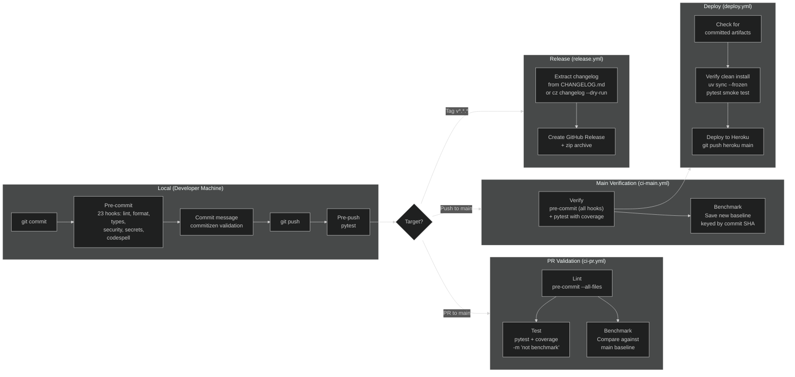
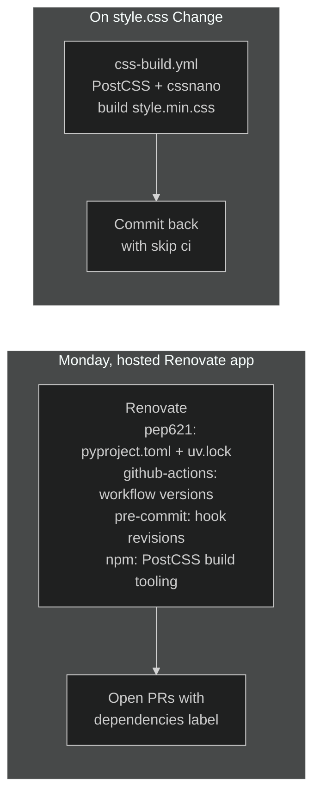

# Contributing to Relic Solver

Thanks for your interest in contributing! This guide covers everything you need
to get a development environment running and submit clean pull requests.

For full documentation, see the **[Official Docs](#)** (coming soon).

- [Development Setup](#development-setup)
- [Environment Variables](#environment-variables)
- [Running Tests](#running-tests)
- [Project Structure](#project-structure)
  - [Key Files](#key-files)
- [Configuration](#configuration)
- [Commit Conventions](#commit-conventions)
- [Pre-commit Hooks](#pre-commit-hooks)
- [CI/CD Workflows](#cicd-workflows)
- [Security Headers](#security-headers)
- [Code Style](#code-style)

## Development Setup

You need [uv](https://docs.astral.sh/uv/) and Python 3.14+.

```bash
# Clone and install
git clone https://github.com/Rovetown/relic-solver.git
cd relic-solver
uv sync

# Install pre-commit hooks
uv run pre-commit install
uv run pre-commit install --hook-type pre-push  # pytest only; the rest run on commit
uv run pre-commit install --hook-type commit-msg

# Run the app locally
uv run flask run
# or
uv run python app.py

# Run the full test suite
uv run pytest
```

## Environment Variables

All optional. Create a `.env` in the project root (already gitignored):

```bash
# Redis - leave unset to disable caching locally
REDISCLOUD_URL=redis://localhost:6379/0
# Or use REDIS_URL as a fallback
REDIS_URL=redis://localhost:6379/0

# CORS - defaults to "*"
CORS_ORIGIN=http://localhost:5000
```

The app runs fine with no `.env` file - caching is disabled and CORS allows
all origins.

## Running Tests

```bash
# Standard run (benchmarks disabled by default)
uv run pytest

# With benchmark timing
uv run pytest --benchmark-enable

# Single test class
uv run pytest tests/unit/test_relic_lib.py::TestSolveEdgeCases

# Verbose with full tracebacks
uv run pytest -v --tb=long
```

<details>
<summary><b>Test Organization</b> (185 tests)</summary>

Tests are grouped by class (185 tests total, including parametrized expansions):

| Class | Tests | What it covers |
|-------|------:|----------------|
| `TestConfigRegression` | 7 | Locks game constants (divine chance, thresholds, caps, rate limits, relic names) |
| `TestSolveEdgeCases` | 18 | Zero inputs, threshold boundaries (threshold+1 rule), single chests, guaranteed outcomes |
| `TestSolveValidation` | 6 | Wrong target lengths, negative inputs, empty tuples, timeout |
| `TestSolveInputEdgeCases` | 7 | Negative targets, cap=0/1, float targets, very large cap |
| `TestSolveImpossibleCases` | 5 | Targets that exceed possible divine counts, near-zero probabilities |
| `TestSolveRealisticScenarios` | 19 | 0 to 2,000,000 chests, various cap values, parametrized scaling |
| `TestSolveMonotonicity` | 5 | More chests = higher probability, harder targets = lower probability, determinism |
| `TestSolveCapClamping` | 3 | Targets above cap are equivalent to targets at cap, D1 is uncapped |
| `TestGetDropDistribution` | 11 | Unlock thresholds, capping logic, probabilities sum to 1, pool size |
| `TestMeetsTarget` | 6 | Exact match, all above, one below, zero cases |
| `TestExpectedRerolls` | 6 | Geometric mean (1/p), infinity at p=0, edge values |
| `TestExpectedGems` | 23 | Rounding to nearest 200, always-multiple-of-cost, never undercount |
| `TestProgressCallback` | 2 | Callback fires with valid values, None default works |
| `TestSolveToGemsPipeline` | 3 | End-to-end: solve -> expected_rerolls -> expected_gems |
| `TestPackageAPI` | 2 | Public imports work, version string accessible |
| `TestCrossValidation` | 13 | NumPy solver matches dict solver within 1e-12 on representative inputs |
| `TestBenchmarks` | 10 | Performance timing at 0 / 1K / 10K / 50K / 100K / 500K / 1M / 2M chests + divine-only + max-cap worst case |

Integration tests (39 tests) live in `tests/integration/` and cover Flask
routes, validation, NDJSON streaming, security headers, ETag handling, response
timing, and Redis cache behavior.

</details>

<details>
<summary><b>Benchmarks</b></summary>

Benchmarks are disabled by default. Run with `--benchmark-enable` to get
per-iteration timing. pytest-benchmark auto-calibrates rounds: fast functions
get thousands, slow ones get 5.

**Total vs Mean:** `test_bench_2m_chests` might show Total ~23s but Mean 3.3s.
Total = 5 rounds x 3.3s + calibration overhead. Mean = one `solve()` call.

</details>

<details>
<summary><b>Test Reports</b></summary>

Each `pytest` run drops a timestamped markdown report in
[`tests/reports/`](tests/reports/) (gitignored, only `.gitkeep` tracked).
Three sections:

**Summary Table** - pass/fail/error/skip counts.

**Detailed Results Table** - full pytest node ID, status, and wall-clock
duration per test. For benchmark tests, the duration column is cumulative
across all rounds + calibration - not per-iteration time.

**Benchmark Results Table** (only with `--benchmark-enable`) - per-iteration
stats: Min, Mean, Max, StdDev, Median, Rounds, OPS, and Total wall-clock time.

</details>

## Project Structure

```
relic-solver/
  app.py                    Flask entry point
  justfile                  Task runner recipes (just dev, just test, etc.)
  pyproject.toml            Dependencies, pytest config, commitizen config
  Procfile                  Heroku production (gunicorn)
  Procfile.windows          Local production-like server (waitress)
  style.css                 Source CSS (style.min.css built by CI)
  docs/
    architecture.md         System architecture (container diagram)
    solver-flow.md          Solver algorithm flowchart
    ci-cd-pipeline.md       CI/CD pipeline diagram
    request-lifecycle.md    Request lifecycle (sequence diagram)
    game-mechanics.md       Game mechanics decision tree
  .github/workflows/
    ci-main.yml             Main branch verification
    ci-pr.yml               Pull request checks
    css-build.yml           Auto-build style.min.css on style.css changes
    deploy.yml              Auto-deploy to Heroku after CI passes
    release.yml             Release workflow
  scripts/
    prewarm_cache.py        Redis cache prewarming
    profile_memory.py       Memory profiling with tracemalloc
    profile_lines.py        Line-level profiling
    profile_e2e.py          End-to-end profiling
  src/
    relic_solver/           Standalone library package (soon pip-installable)
      __init__.py           Public API: solve, expected_rerolls, expected_gems
      __main__.py           cProfile entry point (python -m relic_solver)
      _version.py           Single-source version (__version__ = "2.0.0")
      config.py             All game constants (single source of truth)
      solver.py             Markov chain solver + gem cost functions
      py.typed              PEP 561 type checker marker
    webapp/                 Flask web application assets
      __init__.py           Package init
      static/
        css/style.min.css   Minified CSS (built from root style.css)
        js/solver.js        Frontend logic (NDJSON streaming, form handling)
        robots.txt          Search engine directives
        sitemap.xml         Sitemap for SEO
      templates/
        index.html          Frontend (hand-rolled dark theme, no framework)
  tests/
    conftest.py             Report generation + benchmark integration
    reports/                Auto-generated test reports (.gitignored)
      .gitkeep
    unit/
      test_relic_lib.py     146 unit tests: edge cases, validation, cross-validation, benchmarks
    integration/
      conftest.py           FakeRedis fixture, Flask test client setup
      test_app.py           39 integration tests: routes, validation, NDJSON, security, cache
```

### Key Files

| File | Purpose |
|------|---------|
| [`src/relic_solver/config.py`](src/relic_solver/config.py) | All game constants. Only file to touch when mechanics change. |
| [`src/relic_solver/solver.py`](src/relic_solver/solver.py) | `solve()`, `expected_rerolls()`, `expected_gems()`. |
| [`app.py`](app.py) | Flask entry point. Serves templates/static from `src/webapp/`. |
| [`tests/conftest.py`](tests/conftest.py) | Generates timestamped markdown reports in `tests/reports/`. |
| [`tests/unit/test_relic_lib.py`](tests/unit/test_relic_lib.py) | 146 unit tests, organized by concern. |

## Configuration

All game constants are centralized in
[`src/relic_solver/config.py`](src/relic_solver/config.py):

```python
DIVINE_CHANCE = 1 / 25000        # Per-chest divine probability
UNLOCK_D2_THRESHOLD = 3          # D2 unlocks at 3+ total divines
UNLOCK_D3_THRESHOLD = 6          # D3 unlocks at 6+
UNLOCK_D4_THRESHOLD = 10         # D4 unlocks at 10+
UNLOCK_D5_THRESHOLD = 30         # D5 unlocks at 30+
OBELISK_D2_THRESHOLD = 23        # D2 also needs Obelisk level 23+
OBELISK_D3_THRESHOLD = 25        # D3 also needs 25+
OBELISK_D4_THRESHOLD = 37        # D4 also needs 37+
OBELISK_D5_THRESHOLD = 64        # D5 also needs 64+
DEFAULT_RELIC_CAP = 5            # Shared cap for D2-D5 (range: 5-21)
COST_PER_REROLL = 200            # Gems per reroll
```

When game mechanics change, update this file. The solver and tests import from
`relic_solver.config` directly.

## Commit Conventions

On Windows, point git at the editor wrapper once per clone:

```powershell
git config --local core.editor "<repo>/scripts/cz-editor.cmd"
```

`cz commit --edit` resolves the editor with `shutil.which()` and runs it as
`[editor, file]`, so `core.editor` must be a single executable path with no
arguments. A value such as `"...\code" --wait` fails with
`RuntimeError: Editor '...' not found.`, and a bare `code` returns before the
file is saved. The wrapper holds the `--wait` so the setting stays argument
free. `notepad` works too, with no wrapper.


This project uses [Commitizen](https://commitizen-tools.github.io/commitizen/)
with conventional commits. All commit messages must follow the format:

```
type(scope): description
```

Common types: `feat`, `fix`, `refactor`, `test`, `docs`, `ci`, `chore`.

The commitizen hook validates your message on commit. If it rejects the message,
rewrite it to match the format and commit again.

## Pre-commit Hooks

Three hook stages run automatically. The `default_stages` is `[pre-commit]`,
so hooks without an explicit stage run on every commit. Paths matching
`(^|/)(nul|NUL)$|\.claude/` are excluded globally.

```bash
# Install all hook types (run once after cloning)
uv run pre-commit install
uv run pre-commit install --hook-type pre-push  # pytest only; the rest run on commit
uv run pre-commit install --hook-type commit-msg

# Run all hooks against all files
uv run pre-commit run --all-files

# Run a single hook
uv run pre-commit run <hook-id> --all-files
```

<details>
<summary><b>On commit</b> (17 hooks)</summary>

| Hook | Source | What it does |
|------|--------|--------------|
| `uv-lock` | `astral-sh/uv-pre-commit` | Keeps `uv.lock` in sync with `pyproject.toml` |
| `trailing-whitespace` | `pre-commit-hooks` | Strips trailing whitespace |
| `end-of-file-fixer` | `pre-commit-hooks` | Ensures files end with a newline |
| `check-yaml` | `pre-commit-hooks` | Validates YAML syntax |
| `check-toml` | `pre-commit-hooks` | Validates TOML syntax |
| `check-added-large-files` | `pre-commit-hooks` | Prevents accidental binary commits |
| `debug-statements` | `pre-commit-hooks` | Catches leftover `breakpoint()` / `pdb` |
| `detect-private-key` | `pre-commit-hooks` | Blocks private key files |
| `add-trailing-comma` | `asottile/add-trailing-comma` | Adds trailing commas to multi-line calls |
| `docformatter` | `PyCQA/docformatter` | Normalizes docstrings (`--in-place`, reads `pyproject.toml`) |
| `python-use-type-annotations` | `pygrep-hooks` | Enforces type annotations over type comments |
| `python-no-log-warn` | `pygrep-hooks` | Catches deprecated `logging.warn()` |
| `python-no-eval` | `pygrep-hooks` | Forbids `eval()` |
| `rst-backticks` | `pygrep-hooks` | Catches single backticks in RST (should be double) |
| `rst-directive-colons` | `pygrep-hooks` | Ensures RST directives end with `::` |
| `rst-inline-touching-normal` | `pygrep-hooks` | Flags inline markup touching text without whitespace |
| `yamllint` | `adrienverge/yamllint` | Lints YAML files (config in `.yamllint.yml`) |
| `codespell` | `codespell-project/codespell` | Catches typos (excludes `.min.js` files) |

</details>

<details>
<summary><b>On push</b> (4 hooks)</summary>

These run before `git push` and are heavier checks:

| Hook | Source | What it does |
|------|--------|--------------|
| `mypy` | `mirrors-mypy` | Strict type checking (includes `types-pyyaml`) |
| `bandit` | `PyCQA/bandit` | Security analysis (reads config from `pyproject.toml`) |
| `detect-secrets` | `Yelp/detect-secrets` | Prevents credential leaks (baseline: `.secrets.baseline`) |
| `pytest` | local | Full test suite with coverage (`--cov=relic_solver --cov-report=term-missing`) |

</details>

<details>
<summary><b>On commit message</b></summary>

| Hook | Source | What it does |
|------|--------|--------------|
| `commitizen` | `commitizen-tools/commitizen` | Validates conventional commit format |

</details>

## CI/CD Workflows

All workflows live in [`.github/workflows/`](.github/workflows/) and use
`uv sync --frozen` to ensure reproducible installs.

<details>
<summary><b>Visual: Full pipeline overview</b></summary>



**Automated maintenance** (runs weekly on Monday):



| Workflow | Trigger | Condition |
|----------|---------|-----------|
| `ci-pr.yml` | `pull_request` | Targets `main` |
| `ci-main.yml` | `push` | Branch is `main` |
| `deploy.yml` | `workflow_run` | After `ci-main.yml` succeeds |
| `release.yml` | `push` tags `v*.*.*` | Or manual dispatch |
| `css-build.yml` | `push` / `pull_request` | `style.css` or `postcss.config.js` changed |

| Secret | Used by | Purpose |
|--------|---------|---------|
| `HEROKU_API_KEY` | `deploy.yml` | Heroku git push authentication |
| `HEROKU_APP_NAME` | `deploy.yml` | Target Heroku app name |
| `GITHUB_TOKEN` | `css-build.yml` | Commit built CSS back to branch |

</details>

<details>
<summary><b>PR Validation</b> (<code>ci-pr.yml</code>)</summary>

Runs on every pull request targeting `main`. Two parallel jobs after linting:

```
lint (pre-commit --all-files)
  |-- test  (pytest with coverage, excludes benchmarks)
  +-- benchmark  (pytest --benchmark-only, compares against main baseline)
```

| Job | What runs | Artifacts |
|-----|-----------|-----------|
| **lint** | `uv run pre-commit run --all-files` (all on-commit hooks) | - |
| **test** | `uv run pytest --tb=short --cov=relic_solver --cov-report=term-missing -m "not benchmark"` | `test-reports-pr` |
| **benchmark** | Restores main baseline from cache, runs benchmarks, compares with `--benchmark-compare=main` | `benchmark-pr` |

</details>

<details>
<summary><b>Main Verification</b> (<code>ci-main.yml</code>)</summary>

Runs on every push to `main`. The verify job runs all checks in one pass, then
the benchmark job saves a new baseline for PR comparisons:

```
verify (pre-commit, which includes mypy/bandit/detect-secrets, + tests)
  +-- benchmark  (saves baseline to cache, keyed by commit SHA)
```

| Job | What runs | Artifacts |
|-----|-----------|-----------|
| **verify** | Pre-commit (all hooks, which now includes mypy, bandit and detect-secrets), pytest with coverage | `test-reports-main` |
| **benchmark** | `uv run pytest --benchmark-enable --benchmark-only --benchmark-save=main -v` | `benchmark-main` (also cached for PR comparisons) |

</details>

<details>
<summary><b>Deploy Production</b> (<code>deploy.yml</code>)</summary>

Triggered automatically after Main Verification succeeds (via `workflow_run`).
Does not run on PRs or failed main builds.

| Step | What it does |
|------|--------------|
| **Check for committed artifacts** | Scans tracked files for `__pycache__`, `.pyc`, `.coverage`, `.egg-info/`, etc. Fails if any are found. |
| **Verify clean install** | `uv sync --frozen` + `uv run pytest --tb=short -m "not benchmark" -q` |
| **Deploy to Heroku** | `git push` to Heroku git remote (uses `HEROKU_API_KEY` and `HEROKU_APP_NAME` secrets) |

</details>

<details>
<summary><b>Release</b> (<code>release.yml</code>)</summary>

Runs on version tags (`v*.*.*`) or manual dispatch. Creates a GitHub Release
with changelog extracted from `CHANGELOG.md` (falls back to `cz changelog
--dry-run`) and attaches a zip archive of the repository.

</details>

<details>
<summary><b>CSS Build</b> (<code>css-build.yml</code>)</summary>

Runs on push or PR when `style.css` or `postcss.config.js` changes. Installs
PostCSS + cssnano, builds `src/webapp/static/css/style.min.css`, and commits
the result back to the branch (push events only, with `[skip ci]`).

Contributors do not need Node.js installed locally.

</details>

<details>
<summary><b>Renovate</b> (<code>.github/renovate.json</code>)</summary>

Dependency updates are handled by the hosted [Renovate](https://docs.renovatebot.com)
GitHub App, which replaced Dependabot and the old `tooling-update.yml` workflow.
It runs on Mondays (09:00-12:00 UTC) and opens PRs with the `dependencies` label.

| Manager | What it updates | Commit prefix |
|---------|-----------------|---------------|
| `pep621` | Python deps in `pyproject.toml`, relocking `uv.lock` | `build(deps):` |
| `github-actions` | Action versions in workflow files | `ci(deps):` |
| `pre-commit` | Hook `rev:` pins in `.pre-commit-config.yaml` (grouped into one PR) | `build(tools):` |
| `npm` | PostCSS build tooling in `package.json` | `build(deps):` |

The `pre-commit` manager is disabled by default in Renovate and is opted into
explicitly. Renovate resolves hook versions its own way rather than mimicking
`pre-commit autoupdate`, which is why upstream ships it opt-in. A `groupName`
collapses all hook bumps into a single PR, matching the shape the retired
`tooling-update.yml` produced.

Security updates are separate: `vulnerabilityAlerts` ignores the weekly schedule
and raises PRs as soon as an advisory lands. That data comes from GitHub's
Dependabot **alerts**, which stay enabled -- Renovate reads them rather than
scanning itself. Dependabot version and security *updates* are both off, so
Dependabot opens no PRs.

`lockFileMaintenance` additionally refreshes `uv.lock` on the same weekly
schedule even when no dependency range has changed.

**Dependency constraints are deliberately open-ended.** Most entries in
`pyproject.toml` use `>=` with no upper bound, which is safe because Renovate
raises each major version in its own PR, so nothing lands unreviewed. The one
exception is running `uv lock --upgrade` by hand: it resolves straight to the
newest compatible release and will take majors silently, bypassing that review.
Treat it as a deliberate act and check what moved, rather than a routine
refresh.

</details>

## Subresource Integrity

Nothing is loaded from another origin, so no tag carries `integrity` today.
`test_the_page_loads_nothing_from_another_origin` is what keeps that true, and
`test_any_external_resource_would_carry_sri` holds the rule for the day a CDN
comes back: `integrity` plus `crossorigin="anonymous"`, so the browser refuses
the resource if the host ever serves different bytes.

If you do add one, generate the hash with:

```sh
curl -sSL <url> | openssl dgst -sha384 -binary | openssl base64 -A
```

A stale `integrity` value does not degrade gracefully -- the browser blocks the
resource outright. Renovate does not manage CDN URLs embedded in HTML and could
not recompute the hash if it did, so such a pin is updated by hand.

## Security Headers

All responses go through `_set_security_headers` in `app.py`.

| Header | Value | Purpose |
|--------|-------|---------|
| **Content-Security-Policy** | `default-src 'self'; script-src 'self' ... 'nonce-...'` | Whitelist for loadable resources |
| **X-Content-Type-Options** | `nosniff` | Stops MIME-type sniffing |
| **X-Frame-Options** | `DENY` | No iframe embedding |
| **X-XSS-Protection** | `0` | Disables the legacy XSS Auditor |
| **Referrer-Policy** | `strict-origin-when-cross-origin` | Limits referrer leakage cross-origin |
| **Permissions-Policy** | `camera=(), microphone=(), geolocation=(), payment=()` | Kills unused browser APIs |
| **Strict-Transport-Security** | `max-age=31536000; includeSubDomains` | HTTPS-only for 1 year (TLS only) |

<details>
<summary><b>Header details</b></summary>

### Content-Security-Policy (CSP)

The big one. CSP locks down which origins the browser can load resources from.
If a source is not in the policy, it gets blocked.

**Our policy:**

| Directive | Value | Allows |
|-----------|-------|--------|
| `default-src` | `'self'` | Fallback - same-origin only |
| `script-src` | `'self' 'nonce-...'` | Our JS, and any inline script carrying the nonce |
| `style-src` | `'self' 'nonce-...'` | Our CSS, and the inlined `<style>` carrying the nonce - not inline `style=` attributes, which cannot carry one |
| `img-src` | `'self'` | Same-origin images |
| `connect-src` | `'self'` | XHR/fetch to our origin |
| `font-src` | `'self'` | Same-origin fonts |
| `frame-ancestors` | `'none'` | No iframe embedding from anywhere |

**Why nonces?**

`'unsafe-inline'` for scripts kills the entire point of CSP - any injected
`<script>` runs freely. Hash-based CSP is fragile because a single byte change
(even whitespace) breaks it. Nonces sidestep both problems:
`secrets.token_urlsafe(16)` generates 128 bits of entropy per request. The
nonce goes into both the CSP header and the `<script nonce="...">` attribute.
An attacker injecting HTML has no way to know the nonce, so their script gets
blocked.

**Why `'unsafe-inline'` is fine for styles:**

Inline `style=` attributes cannot run code. Worst case is visual defacement,
not script execution. Nonce-protecting every style attribute is not worth the
hassle, and most production CSPs skip it.

### X-XSS-Protection

Set to `0`, which switches the legacy XSS Auditor **off**. That looks backwards
but is the current OWASP recommendation.

The auditor was a browser-side reflected-XSS filter. It has been removed from
Chrome, Edge and Firefox, but still ships enabled in Safari. Its filtering is
abusable: an attacker can craft a request that makes the auditor suppress a
legitimate script, introducing a flaw into a page that had none, and its
behaviour has been used to build cross-site leak primitives.

Omitting the header is not equivalent to disabling it -- Safari then falls back
to its default, which is enabled. It has to be sent explicitly.

The real defence against XSS here is the CSP above, which is far stronger.

### X-Content-Type-Options

`nosniff` stops browsers from guessing the MIME type of a response. Without
it, a browser could treat a text file as JavaScript if the content looks
script-like.

### X-Frame-Options

Clickjacking defense. `DENY` prevents any site from embedding the page in an
iframe. Overlaps with `frame-ancestors 'none'` in CSP, but older browsers
need the standalone header.

### Referrer-Policy

`strict-origin-when-cross-origin` means: full URL for same-origin navigation,
origin-only (no path/query) for cross-origin, and nothing at all on HTTPS-to-HTTP
downgrades.

### Permissions-Policy

Turns off camera, microphone, geolocation, and payment APIs. The app does not
use any of them, so they should not be available - not even to injected scripts.
Replaces the older `Feature-Policy` header.

### Strict-Transport-Security (HSTS)

After the first HTTPS visit, the browser refuses plain HTTP for 1 year
(`max-age=31536000`). Stops SSL stripping attacks.

**Conditional:** only sent when `X-Forwarded-Proto: https` is present (Heroku's
load balancer sets this). Omitted during local HTTP development so `localhost`
does not get locked to HTTPS.

</details>

<details>
<summary><b>How to verify</b></summary>

### Automated Tests

`TestSecurityHeaders` in `tests/integration/test_app.py` covers all headers:

```bash
uv run pytest tests/integration/test_app.py::TestSecurityHeaders -v
```

Checks CSP presence, nonce uniqueness across requests, X-Frame-Options,
X-Content-Type-Options, Referrer-Policy, Permissions-Policy, and conditional
HSTS.

### Manual (local)

```bash
flask run
# In another terminal:
curl -sI http://localhost:5000/ | grep -iE "content-security|x-frame|x-content|referrer|permissions|strict-transport"
```

Or just open DevTools > Network tab > click a request > Response Headers.

### Online Scanners (production)

Run these against the live Heroku URL after any deploy that touches headers:

| Tool | URL | Notes |
|------|-----|-------|
| **SecurityHeaders.com** | https://securityheaders.com | Grades A-F. Aim for A or A+. |
| **Mozilla Observatory** | https://observatory.mozilla.org | Broader audit - CSP, cookies, redirects, etc. |
| **CSP Evaluator** | https://csp-evaluator.withgoogle.com | Paste your raw CSP value. Google's tool, flags weaknesses. |

### Limits

Headers handle a specific set of attacks: XSS (CSP), clickjacking
(X-Frame-Options / frame-ancestors), transport downgrades (HSTS), and API
abuse (Permissions-Policy). They do not cover application-level bugs like
broken auth, missing input validation, or logic flaws. Different layer,
different tools.

</details>

## Code Style

- **mypy strict mode** - all Python must pass `mypy --strict`
- **ruff (UP rules)** - modern Python syntax required
- **No `from __future__ import annotations`** - Python 3.13+ native syntax
- **`Callable`** imported from `collections.abc` at runtime (not `TYPE_CHECKING`)
- **LBYL validation** - check before you act, don't catch exceptions for control flow
