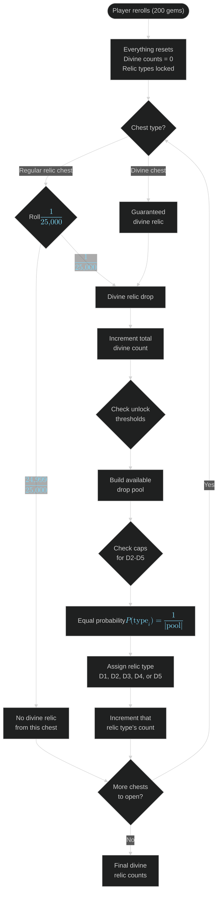
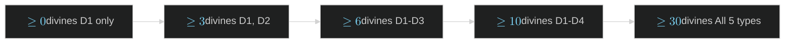
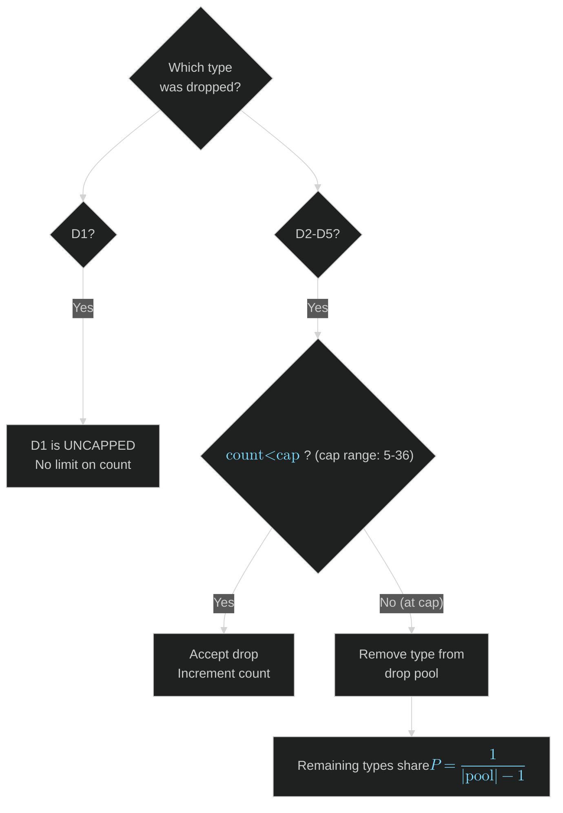
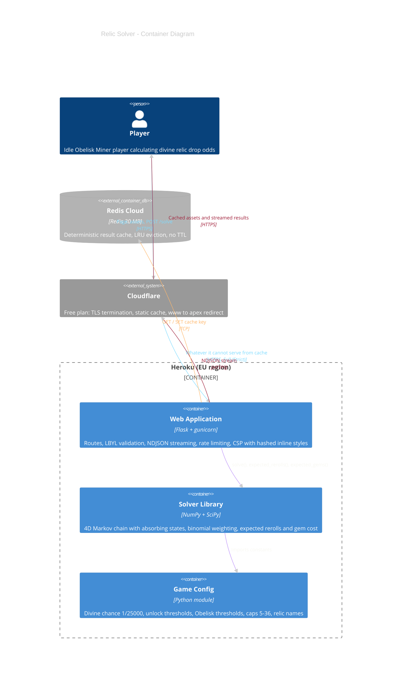
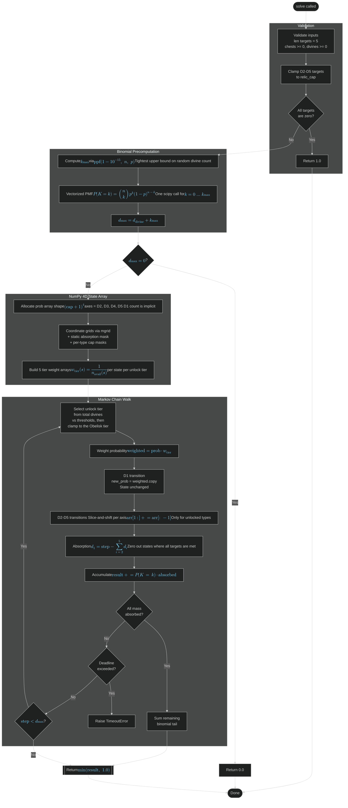
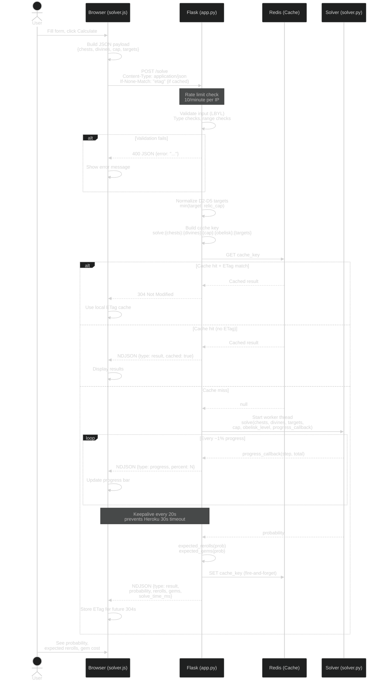
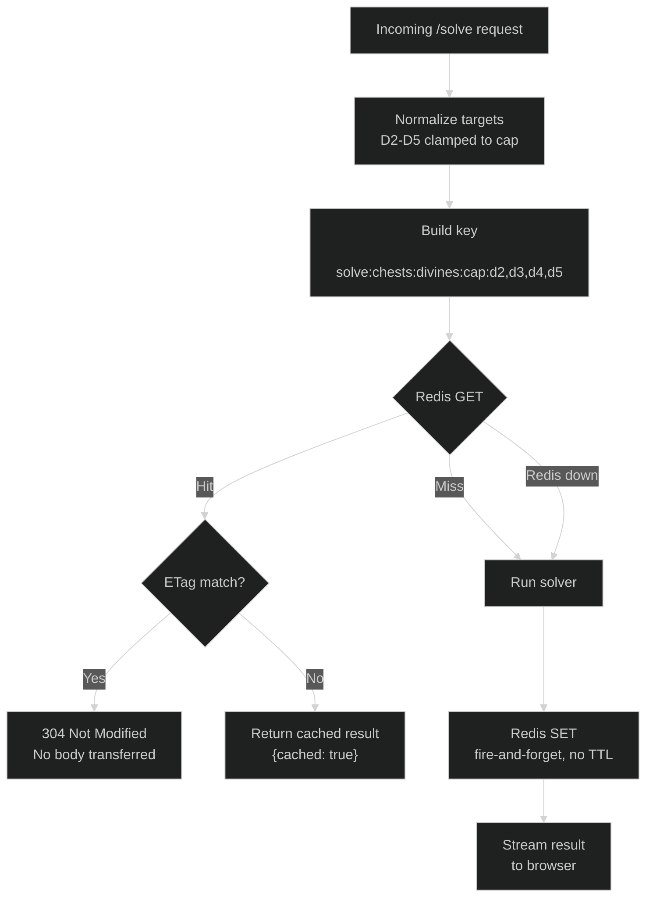

# Relic Solver

[](https://github.com/Rovetown/relic-solver/tags)
[](https://github.com/Rovetown/relic-solver/actions/workflows/ci-main.yml)
[](https://www.python.org/)
[](LICENSE)

Work out the odds of hitting a set of divine relic targets in a single reroll
of [Idle Obelisk Miner](https://apps.apple.com/app/idle-obelisk-miner/id6448125670).
Enter how many chests you have and which relics you want; the answer comes back
as a probability, an expected number of rerolls, and a gem cost.

**[iomreliccalc.me](https://iomreliccalc.me)**

An unofficial tool. Not affiliated with Checkbox Entertainment.

## What it computes

The same question, four ways. Stop at whichever level answers it for you.

**If you have never played.** You open chests. A few of them hold a rare relic.
You want a certain number of certain relics. This works out your chances.

**If you play the game.** Regular chests almost never drop a divine relic: one
in 25,000. Divine chests always drop one. Which relic you get depends on how
many you already hold, because new kinds unlock as your total grows and each
kind stops dropping once it hits its cap. So the order the drops arrive in
changes the answer, and you cannot get there by multiplying a few numbers
together.

**If you have met probability before.** Each drop moves you from one state to
another, where a state is how many of each of the five relic types you hold.
That is a Markov chain. Some states are winning states, and once you reach one
you stay in it, because relic counts only ever go up. Walk the chain forward,
adding up the probability that lands in a winning state, and you have the
answer for a fixed number of drops. The number of drops is itself random, so
weight each possible count by how likely it is and add those up too.

**If you want the implementation.** A forward walk over an absorbing Markov
chain held in a dense 4D array indexed by the D2 to D5 counts, with D1 implied
by the step number minus the rest. Transitions are slice-and-shift along each
axis against per-tier uniform weights; absorption is a boolean mask. The outer
sum weights the cumulative absorbed mass at each step by the Binomial(n,
1/25000) PMF, truncated at the `ppf` of `1 - 1e-15`.

## Game mechanics

### Divine drops

- Regular relic chests have a **1 in 25,000** chance of producing a divine relic.
- Divine chests produce exactly one each.
- Rerolling resets everything. Divines accumulate only within a single reroll.

### Unlock thresholds

Five relic types, unlocked by the **total** divines accumulated so far:

| Total divines | Types available | Newly unlocked |
|:-------------:|-----------------|----------------|
| 0 | D1 | Rainbow Floor Chance |
| 3 | D1, D2 | Supernova Multiplier |
| 6 | D1 to D3 | Rainbow Floor Multiplier |
| 10 | D1 to D4 | Fishing Ticks 5x Chance |
| 30 | D1 to D5 | Rainbow Void Portal Chance |

Thresholds are checked **before** each drop, which costs people a reroll more
often than anything else here. With exactly three divine chests, all three land
on D1: the totals seen beforehand are 0, 1 and 2, and none of them has reached
3. A type needs **threshold + 1** divines before it can receive its first drop,
so D2 needs four, not three.

### Obelisk level

Divines owned are not the only gate. Your Obelisk level gates the same types,
and **both** gates must be open before a type can drop:

| Type | Divines owned | Obelisk level |
|------|:-------------:|:-------------:|
| D1 Rainbow Floor Chance | 0 | none |
| D2 Supernova Multiplier | 3 | 23 |
| D3 Rainbow Floor Multiplier | 6 | 25 |
| D4 Fishing Ticks 5x Chance | 10 | 37 |
| D5 Rainbow Void Portal Chance | 30 | 64 |

Obelisk level does not change inside a reroll, so it is a fixed ceiling on the
unlock tier rather than a per-drop check. A target on a type your level locks
out is impossible, and the solver returns 0 for it without walking the chain.
Locking the higher types can make a lower target **more** likely, because the
drops that would have gone to them land on what is left.

The page offers the level as five bands, one per threshold: below 23, 23 to 24,
25 to 36, 37 to 63, and 64+, and starts on the lowest. `obelisk_level` is a
required field of the `/solve` body: a request without it is answered with
`400 Missing fields`, because a level the caller never stated cannot be
guessed without changing the answer.

### Caps

D1 is uncapped. D2 to D5 share one configurable cap, between 5 and 36. A type
that reaches the cap leaves the drop pool, and the types still in the pool
share its probability equally.

### Cost

A reroll costs 200 gems. Expected cost is `ceil(expected_rerolls) * 200`,
rounded up because you cannot buy part of a reroll.

## How the solver works

[`src/relic_solver/solver.py`](src/relic_solver/solver.py).

**Bound the random part.** Divines from regular chests follow Binomial(n,
1/25000). Rather than loop over every chest, the solver asks SciPy for the
smallest `k_max` with `P(K <= k_max) >= 1 - 1e-15`. For 150,000 chests that is
about 25 possible counts instead of 150,000.

**Walk the chain.** Each drop is one step. For every live state, work out which
types are unlocked by divines owned and by Obelisk level and still under the
cap, split the state's probability equally between them, and move it.

**Absorb the winners.** A state that meets the target in every dimension is
removed and its probability added to a running total. This is safe because
counts only increase, so every descendant of a winning state also wins. It is
also what stops the state space exploding.

**Weight and sum.** After `d` total drops the result takes on
`P(K = k) * absorbed(d)`. Weighting the cumulative absorbed mass at each step
is equivalent to tracking when each state was first absorbed, without having
to track it.

### Two implementations

`_solve_numpy` is the default: one dense array of shape `(cap+1)^4`, with
transitions as array slices rather than a loop over states. `_solve_dict` is
the original per-state version, kept because two implementations that agree
are evidence and one is an assertion. Thirteen parametrised tests check they
agree to within `1e-12`.

Measured at cap 21 with 2 million chests, the array version takes about 500 ms
against 105 s for the dict version.

## Technical detail

Everything above is the whole story. What follows is the same material drawn
out, for anyone who wants to see the shape of it rather than read about it.

<details>
<summary><b>How a reroll plays out</b></summary>

#### Reroll flow



#### Unlock thresholds



Thresholds are checked *before* each drop. With exactly 3 divine chests,
all 3 land on D1 (totals seen: 0, 1, 2). D2 needs at least **4** divines
to receive its first drop, not 3.

#### Cap system



#### Example walkthrough

**Setup**: 10 divine chests, cap = 5, targets = (0, 2, 0, 0, 0)

| Drop # | Total before | Available pool | Drop lands on | State (D1-D5) |
|:------:|:------------:|----------------|:-------------:|:-------------:|
| 1 | 0 | D1 | D1 | (1,0,0,0,0) |
| 2 | 1 | D1 | D1 | (2,0,0,0,0) |
| 3 | 2 | D1 | D1 | (3,0,0,0,0) |
| 4 | 3 | D1, D2 | D2 (50%) | (3,1,0,0,0) |
| 5 | 4 | D1, D2 | D1 (50%) | (4,1,0,0,0) |
| 6 | 5 | D1, D2 | D2 (50%) | (4,2,0,0,0) |
| 7 | 6 | D1, D2, D3 | D1 (33%) | (5,2,0,0,0) |
| ... | | | | Target met at drop 6 |

This is one possible path. The solver computes the probability across
**all** possible paths simultaneously using the Markov chain.

</details>

<details>
<summary><b>System architecture</b></summary>



| Path | Protocol | Notes |
|------|----------|-------|
| Browser to Cloudflare | HTTPS (edge TLS termination) | JSON request, NDJSON response |
| Cloudflare to Flask | HTTPS, Full (Strict) | Cache miss, or anything uncacheable |
| Flask to Redis | TCP (REDISCLOUD_URL) | Deterministic cache, no TTL |
| Flask to Solver | In-process function call | Worker thread for long solves |
| Browser to Cloudflare (static) | HTTPS, served from the edge cache | Scripts, fonts and images, all same-origin; the stylesheet is inlined in the page |

</details>

<details>
<summary><b>The solver, step by step</b></summary>

The solver computes:

$$P(\text{success}) = \sum_{k=0}^{k_{\max}} P(K = k) \cdot P(\text{target met} \mid d_{\text{divine}} + k \text{ total drops})$$

where $K \sim \text{Binomial}(n, p)$ is the random divine count from $n$
regular chests at $p = \frac{1}{25{,}000}$ per chest.



| Input range | Behavior |
|-------------|----------|
| 0 chests, 0 divines | Returns 0.0 immediately ($d_{\max} = 0$) |
| All-zero targets | Returns 1.0 immediately (trivial case) |
| Small inputs (< 10K chests) | Dict solver would be faster (~70us overhead from array allocation) |
| Typical inputs (10K-500K) | NumPy solver handles in < 100ms |
| Measured at cap 21, 2M chests | ~500ms, against 105s for the dict solver |

</details>

<details>
<summary><b>What happens when you press Run Solver</b></summary>



#### NDJSON message types

| Type | Fields | When sent |
|------|--------|-----------|
| `progress` | `percent` (0-100) | Every ~1% of Markov chain steps |
| `progress` | `percent: -1` | Keepalive (every 20s if solver is slow) |
| `result` | `probability`, `expected_rerolls`, `expected_gems`, `solve_time_ms` | Solver finished |
| `result` | Same + `cached: true` | Cache hit (single line, no progress) |
| `error` | `error` (string) | Solver raised ValueError or TimeoutError |

#### Caching strategy



</details>

## Running it locally

**Needs:** Python 3.14+, [uv](https://docs.astral.sh/uv/),
[Node.js](https://nodejs.org/) for the CSS and JS build, and
[just](https://github.com/casey/just) to drive the recipes.

```sh
just sync     # uv sync + npm install
just dev      # build assets, then run on http://127.0.0.1:5000
just test     # the Python suite
just --list   # everything else
```

Run the dev server through `just dev` rather than `flask run`. It passes
`--debug`, and without it Flask caches templates in memory and will serve you
markup from before your last edit.

Redis is optional. Without it the result cache and the rate limiter both fall
back to in-process storage, which is fine for development and wrong for
production, where every worker would keep its own counters.

## Documentation

- [CONTRIBUTING.md](CONTRIBUTING.md) covers the test suites, project layout,
  commit conventions and pre-commit hooks.
- [DEPLOYMENT.md](DEPLOYMENT.md) covers Heroku, the environment variables and
  the deploy commands.

## Author

**Rovetown** ([@Rovetown](https://github.com/Rovetown))

Issues and pull requests are welcome at
[the issues page](https://github.com/Rovetown/relic-solver/issues).

## License

Copyright 2026 [Rovetown](https://github.com/Rovetown).
[MIT](LICENSE) licensed.
